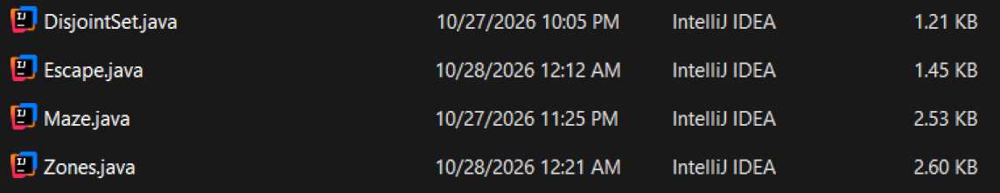
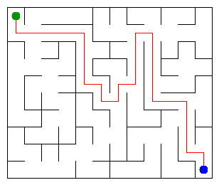

# Assignment 3. Maze Escape

Student ID: 252881
Name: Danial
Group: Bolatov
Maze size (rows x columns): 10x12

for some reason my commits didn't go through so now all of these commits seem like they're recent

This file is the report. Fill it in as you go. How to start: `START_HERE.md`. The task: `docs/Assignment3.pdf`.

## Program output

The 13 lines your program prints on your data (`java -cp out Main`):

    Broken: 119
    Kept: 99
    Last broken wall: 178
    MST cost: 33413
    Heaviest broken wall: 707
    Path length: 28
    DFS visited: 56
    Dead ends: 38
    Zones: 120
    Largest zone: 1
    Is DAG: 1
    Flow stages: 22
    Fastest route cost: 21

My maze:

## Questions

Answer in your own words, two or three sentences each.

Mission 0. What do find and union do, and what makes them fast in your code?
>   find returns cell's component, union joins two different components

Mission 1. Why is Broken always R*C - 1, and Kept always (R-1)*(C-1)?
>   Because every successful union reduces the count by one
>   Substracting broken walls leaves (R-1)*(C-1)

Mission 2. My MST cost from Kruskal and from Prim, and why they are equal:
>   MST cost given to me is 33413
>   All wall costs are unique, and the graph is connected, making sure that there is only one unique MST for the graph, so both Kruskal and Prim find the same one

Mission 3. Why is there exactly one path between two cells? How did you avoid a stack overflow on a huge maze?
>   Two different paths between two cells would create a cycle, that's why there's only one path

Mission 4. Why does the second pass of Kosaraju go on the reversed graph? Why do the slides have no cycle exactly when Zones equals the number of cells?
>   

Mission 5. Why is it enough to go through the zones in the order of their numbers? What does this pass cost?
>

## AI use

Used ChatGPT at some places of the project for code review and helping with implementation of some stuff, also helping with structure
## Timing (Mission 7)

Milliseconds, 5 runs each, from `java -cp out Bench`.

| maze | Kruskal | Prim |
|---|---------|------|
| 100 x 100 | 7       | 11   |
| 300 x 300 | 31      | 116  |
| 1000 x 1000 | 863     | 4915 |
    size   kruskal_ms (5 runs, then average)   prim_ms (5 runs, then average)
    100    18 8 5 3 4  avg 8    29 11 11 8 9  avg 14
    300    36 26 25 25 25  avg 27    133 128 119 117 119  avg 123
    1000   407 442 472 1884 1112  avg 863    2572 2661 4825 7489 7029  avg 4915
What do the numbers say about how the time grows? Two or three sentences.
Both times grow with size, however Kruskal has a much more efficient algorithm compared to Prim.
## Complexity

n is the number of cells, m the number of walls (or slides). Fill in every algorithm you wrote.

| algorithm | time      | space  | assumptions |
|---|-----------|--------|---|
| DSU find and union | O(a(n))   | O(1)   | |
| Kruskal | O(m logm) | O(n+m) | |
| Prim | O(m logm) | O(n+m) | |
| DFS | O(n)      | O(n)   | |
| Kosaraju | O(n+m)    | O(n+m) | |
| Route in the zone graph | O(n+m)    | O(n+m) | |

## Before you submit

- data/walls.txt, data/slides.txt and output/maze.png are in the repository.
- `java tools/Check.java` shows all examples right.
- This README is filled in, the program output and the section AI use included.
- The work is pushed to main (at least one commit per mission) and the repository is public.
- The link is attached in Moodle.
